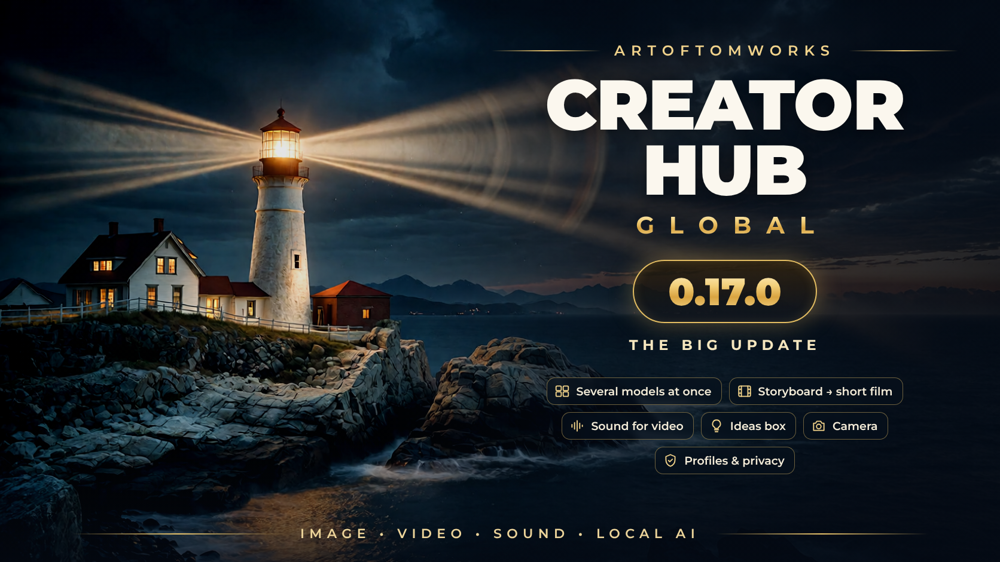

# ArtofTomworks Creator Hub Global

**Your local image & video studio, powered by ComfyUI.** Public Beta 0.14.1.

Choose a supported local model, add compatible LoRAs and create images or videos
from a clear workspace with visible generation, live preview and organized history.
Open ComfyUI's graph editor whenever you need it. SwarmUI is not required.

**HU · EN · DE · FR · ES · IT · PT · PL** — remembered interface language,
without changing your prompts, model names or settings. Technical diagnostics can
fall back to English; third-party tools keep their own language handling.

## 0.14.1 bugfix update

Independent custom sampler/scheduler switches, advice-only model-card recommendations, per-model settings, MOSS CFG correction, improved local image-to-prompt requests and immediate Stop AI. See [update instructions](UPDATE_EN.txt) / [frissítés magyarul](UPDATE_HU.txt).

## Download and start

[Download the Windows x64 ZIP](downloads/ArtofTomworks_CreatorHub_0.14.1_GLOBAL_Windows_x64.zip)

1. Extract the entire ZIP into a writable folder.
2. Run `START_CREATOR_HUB.cmd` and keep the server window open.
3. Choose a ready model, enter a prompt and generate one result to start.

**Requires an existing working ComfyUI installation with its own Python environment,
models and required nodes.** The Windows ZIP includes Node.js 24 x64. It does not
include ComfyUI, generative model weights, Ollama or the optional 9B AI model.
A MediaPipe pose landmark asset is included under its original license.

[English instructions](README_EN.txt) · [Magyar útmutató](README_HU.txt) ·
[Changes](CHANGELOG_EN.txt) · [First start](START_HERE_EN.txt)

[Quick-start guide](GUIDE_EN.md) · [Magyar guide](GUIDE_HU.md)

## In the workspace

- Image/video generation, resolution presets, custom sizes and sampling controls.
- Random/fixed/stepped seeds; sequential series and visible stop controls.
- Local/online model browsing, favorites and compatibility-aware LoRA choices.
- Active model and LoRA strip with temporary disable/enable.
- Date-based image/video history, ratings, categories, selection and trash.
- Large media viewer, metadata inspection and explicit parameter reuse.
- Creative recipes, camera-motion prompts, pose tools and comparison.
- Image editor, Loop Lab, video workshop, finishing, Prompt Studio and Scene DNA.
- Optional local AI assistant with suggestions you explicitly apply.

Automatic model assembly supports documented branches of SD 1.x/2.x, SDXL,
FLUX.1, Krea 2, MOSS, H3 and LTX 2.5 with matching installed components.
This does not mean every architecture, quantization or custom-node combination
is supported. A suitable custom workflow can be imported for other branches.
See the full instructions before downloading large models.

## Source setup and checks

Node.js 22+ is required. No npm installation is needed.

```text
node server.mjs --open
node --test tests/*.test.mjs
```

The unit/service tests use controlled backends and do not generate with a real AI
model. The optional CPU Loop integration test is enabled by `HUB_TEST_PYTHON`,
pointing to a Python environment with its media dependencies. Browser Global
regression: Python 3 + aiohttp, `HUB_TEST_NODE` and `HUB_TEST_BROWSER` (Chromium).
Run `python tests/browser_global_test.py` from the repository root.

User data, local model weights, credentials and developer caches are excluded.
Back up the Hub `data` folder AND your ComfyUI output media before upgrades.
Closing a browser tab does not cancel a running generation.

## License, credits and support

Free personal and commercial creative use under [LICENSE.txt](LICENSE.txt).
Software resale is restricted; this is a source-available Free Use license.
Third-party components and models keep their own terms: [credits](THIRD_PARTY.md).

[Support development on Ko-fi](https://ko-fi.com/artoftomworks)

Please report version, model family, action and copied error with private details
removed. This is a public beta; no universal compatibility or GPU speed is promised.
